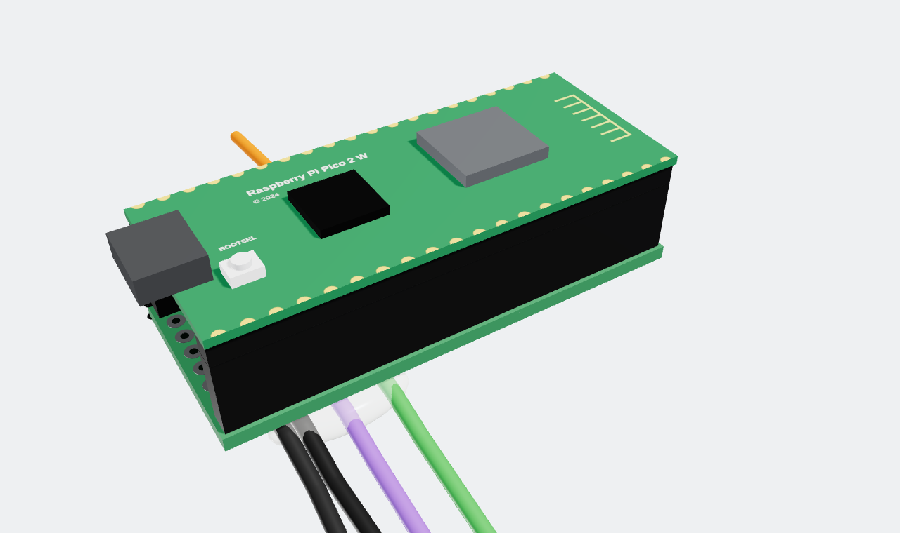

# BC-250 Pico Power Bridge

Turn an **AMD BC-250** board (running Bazzite / SteamOS) into a console that wakes up
when you press the PS button on a **DualSense**.

A **Raspberry Pi Pico 2 W**, powered from the ATX 5 V standby rail, runs a fork of
[DS5Dongle](https://github.com/awalol/DS5Dongle) (low-latency wireless DualSense → USB)
and also controls the power supply's `PS_ON` line through an optocoupler. An optional
12 mm illuminated push button on the case front adds power-on, forced power-off and
pairing.

## How it works

- **Machine off:** the Pico stays alive on 5 V standby. When a paired DualSense connects,
  it pulls `PS_ON` low through the PC817 and the PSU starts. The BC-250 boots by itself
  as soon as it gets 12 V.
- **Machine on:** the Pico reads the BC-250's power-sense signal (TPMS1 header, pin 9).
  When Bazzite shuts down and the signal stays low for 3 s, the Pico releases `PS_ON`
  and the PSU goes back to standby. All controllers are disconnected (pairings are kept)
  and connections are ignored for 15 s.
- **Button:** while off, any press powers on. While on: hold 4 s = forced power-off,
  double click = pairing mode (30 s), single click = reserved.

## Repository layout

| Path | Contents |
| --- | --- |
| [`docs/Complete_manual_Pico2W_BC250_EN.pdf`](docs/Complete_manual_Pico2W_BC250_EN.pdf) | **Start here.** 44-page step-by-step manual: part 1 the board, part 2 the power button. Every step has a 3D render, hole diagram and multimeter checks. |
| [`docs/images/`](docs/images/) | Renders used in the manual |
| [`firmware/prompt.md`](firmware/prompt.md) | The prompt used to generate the firmware with Claude Code (fork of DS5Dongle) |
| [`firmware/tests/`](firmware/tests/) | MicroPython hardware tests from the manual (run them before flashing the firmware) |
| [`hardware/enclosure/`](hardware/enclosure/) | 3D-printed case for the board (OpenSCAD source + STL) |
| [`hardware/redux-button-adapter/`](hardware/redux-button-adapter/) | Adapter to fit a 12 mm button in the REDUX BC-250 case faceplate |
| [`hardware/ssd-spacer/`](hardware/ssd-spacer/) | Dummy 2.5" SSD to fill the unused drive slot of the REDUX case |

## Circuit at a glance

Perfboard 20 × 8 holes (columns C1–C20, rows R1–R8, USB end = C1). The Pico sits on two
1 × 20 female headers on rows R1 and R8.

| Ref | Part | Role |
| --- | --- | --- |
| D1 | 1N5819 Schottky diode | 5 V standby (purple ATX wire) → Pico VSYS, no back-feed when USB is plugged in |
| U1 | PC817 optocoupler | Pulls `PS_ON` (green ATX wire) to ground; keeps 5 V away from the 3.3 V Pico |
| R1 | 330 Ω | PC817 LED current (~6 mA) |
| R2 | 1 kΩ (inline on the orange wire) | Protects GP26 and the BC-250 sense pin |
| J1, J2 | 1 × 20 female headers, 8.5 mm | Make the Pico removable, leave room for parts underneath |

| Pico pin | GPIO | Use |
| --- | --- | --- |
| 39 | VSYS | Power, from D1 |
| 11 | GP8 | Output → 330 Ω → PC817 LED (high = PSU on) |
| 31 | GP26 | Input, internal pull-down ← 1 kΩ ← TPMS1 pin 9 (high = BC-250 on) |
| 14 | GP10 | Button contact, internal pull-up (pressed = 0) |
| 16 | GP12 | Button LED cathode via 220 Ω, PWM, active low |
| 3, 8, 18 | GND | ATX/TPMS1 ground, PC817, button contact |

Button wiring (part 2 of the manual):

| Wire | Path |
| --- | --- |
| LED + (red) | C5-R5 → bridge → C5-R4 (5 V standby) |
| LED − (black) | 220 Ω inline, outside the case → C16-R7 → bridge → C16-R8 (GP12) |
| Contact | C14-R7 → bridge → C14-R8 (GP10) |
| Contact | C18-R7 → bridge → C18-R8 (GND) |

> **RP2350 erratum E9:** on early Pico 2 W chips (stepping A2) the internal pull-down on
> GP26 may be too weak and the sensor reads "on" with the BC-250 off. Fix: a 4.7 kΩ
> resistor between the orange and black wires at the TPMS1 connector end.

## Build order

1. Print the parts in `hardware/` (PLA or PETG, 0.2 mm layers, no supports).
2. Build the board: manual part 1, steps 1–12.
3. Run tests 1–3 (`firmware/tests/01…03`) with MicroPython.
4. Add the button: manual part 2, then tests 4–7.
5. Generate and flash the firmware from [`firmware/prompt.md`](firmware/prompt.md).
6. Close the board in the enclosure and mount everything in the case.

**Safety:** work with the PSU unplugged. 5 V standby is live whenever the PSU is plugged
in and its rear switch is on, even with the fans stopped.

## Credits and licence

- Firmware base: [awalol/DS5Dongle](https://github.com/awalol/DS5Dongle) (see its own licence).
- The REDUX case and faceplate are third-party designs; only the adapter and the spacer are part of this project.

Everything in this repository is released under the [MIT licence](LICENSE).
