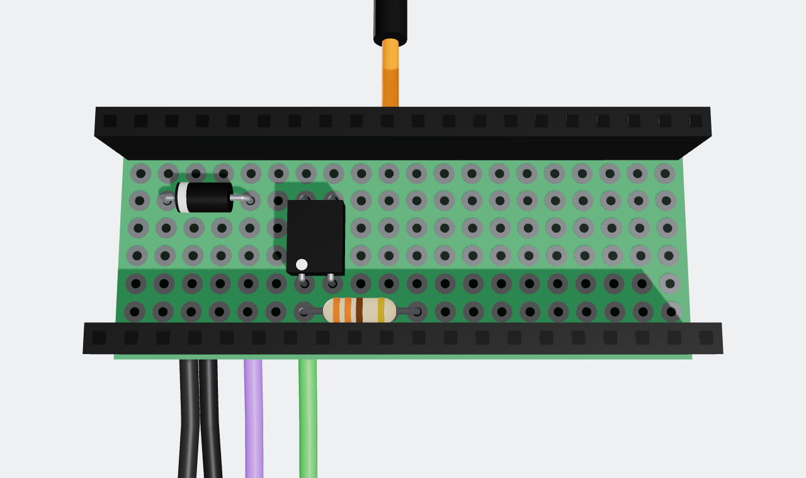
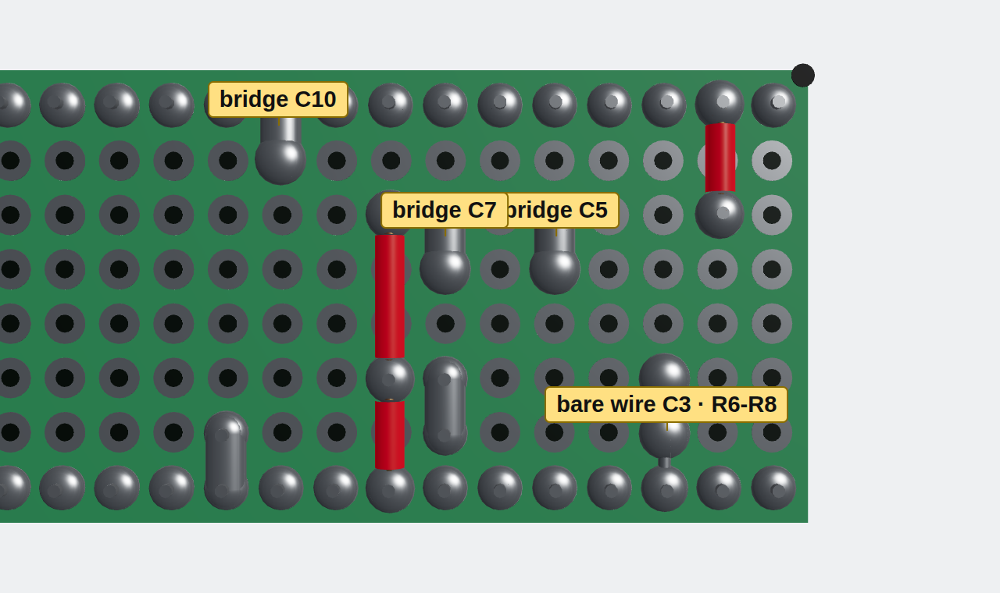

# BC-250 Pico Power Bridge

Turn an **AMD BC-250** board (running Bazzite / SteamOS) into a console that wakes up
when you press the PS button on a **DualSense**.

A **Raspberry Pi Pico 2 W**, powered from the ATX 5 V standby rail, runs a fork of
[DS5Dongle](https://github.com/awalol/DS5Dongle) (low-latency wireless DualSense → USB)
and also controls the power supply's `PS_ON` line through an optocoupler. An optional
12 mm illuminated push button on the case front adds power-on, forced power-off and
pairing.

## How it works

- **Machine off:** the Pico stays alive on 5 V standby. When a paired DualSense connects,
  it pulls `PS_ON` low through the PC817 and the PSU starts. The BC-250 boots by itself
  as soon as it gets 12 V.
- **Machine on:** the Pico reads the BC-250's power-sense signal (TPMS1 header, pin 9).
  When Bazzite shuts down and the signal stays low for 3 s, the Pico releases `PS_ON`
  and the PSU goes back to standby. All controllers are disconnected (pairings are kept)
  and connections are ignored for 15 s.
- **Button:** while off, any press powers on. While on: hold 4 s = forced power-off,
  double click = pairing mode (30 s), single click = reserved.

## Repository layout

| Path | Contents |
| --- | --- |
| [`docs/Complete_manual_Pico2W_BC250_EN.pdf`](docs/Complete_manual_Pico2W_BC250_EN.pdf) | **Start here.** 44-page step-by-step manual: part 1 the board, part 2 the power button. Every step has a 3D render, hole diagram and multimeter checks. |
| [`docs/images/`](docs/images/) | Renders used in the manual |
| [`firmware/prompt.md`](firmware/prompt.md) | The prompt used to generate the firmware with Claude Code (fork of DS5Dongle) |
| [`firmware/tests/`](firmware/tests/) | MicroPython hardware tests from the manual (run them before flashing the firmware) |
| [`hardware/enclosure/`](hardware/enclosure/) | 3D-printed case for the board (OpenSCAD source + STL) |
| [`hardware/redux-button-adapter/`](hardware/redux-button-adapter/) | Adapter to fit a 12 mm button in the REDUX BC-250 case faceplate |
| [`hardware/ssd-spacer/`](hardware/ssd-spacer/) | Dummy 2.5" SSD to fill the unused drive slot of the REDUX case |

## Circuit at a glance

Perfboard 20 × 8 holes (columns C1–C20, rows R1–R8, USB end = C1). The Pico sits on two
1 × 20 female headers on rows R1 and R8.

| Ref | Part | Role |
| --- | --- | --- |
| D1 | 1N5819 Schottky diode | 5 V standby (purple ATX wire) → Pico VSYS, no back-feed when USB is plugged in |
| U1 | PC817 optocoupler | Pulls `PS_ON` (green ATX wire) to ground; keeps 5 V away from the 3.3 V Pico |
| R1 | 330 Ω | PC817 LED current (~6 mA) |
| R2 | 1 kΩ (inline on the orange wire) | Protects GP26 and the BC-250 sense pin |
| J1, J2 | 1 × 20 female headers, 8.5 mm | Make the Pico removable, leave room for parts underneath |

| Pico pin | GPIO | Use |
| --- | --- | --- |
| 39 | VSYS | Power, from D1 |
| 11 | GP8 | Output → 330 Ω → PC817 LED (high = PSU on) |
| 31 | GP26 | Input, internal pull-down ← 1 kΩ ← TPMS1 pin 9 (high = BC-250 on) |
| 14 | GP10 | Button contact, internal pull-up (pressed = 0) |
| 16 | GP12 | Button LED cathode via 220 Ω, PWM, active low |
| 3, 8, 18 | GND | ATX/TPMS1 ground, PC817, button contact |

Button wiring (part 2 of the manual):

| Wire | Path |
| --- | --- |
| LED + (red) | C5-R5 → bridge → C5-R4 (5 V standby) |
| LED − (black) | 220 Ω inline, outside the case → C16-R7 → bridge → C16-R8 (GP12) |
| Contact | C14-R7 → bridge → C14-R8 (GP10) |
| Contact | C18-R7 → bridge → C18-R8 (GND) |

> **RP2350 erratum E9:** on early Pico 2 W chips (stepping A2) the internal pull-down on
> GP26 may be too weak and the sensor reads "on" with the BC-250 off. Fix: a 4.7 kΩ
> resistor between the orange and black wires at the TPMS1 connector end.

## Building the circuit

This is a condensed version of the [complete manual](docs/Complete_manual_Pico2W_BC250_EN.pdf),
which has a 3D render and an exact hole diagram for every step. Follow the steps in order:
they go from the lowest components to the tallest, then the connections underneath, then
the external wires.

### Parts

**Board**

| Qty | Part |
| --- | --- |
| 1 | Raspberry Pi Pico 2 WH (pre-soldered headers) |
| 2 | 1 × 20 female header, 8.5 mm tall |
| 1 | Perfboard, cut to 20 × 8 holes |
| 1 | 1N5819 Schottky diode (a 1N4007 also works: the Pico gets ~4.3 V instead of 4.7 V) |
| 1 | PC817 optocoupler, DIP-4 |
| 1 | 330 Ω resistor (orange-orange-brown-gold) |
| 1 | 1 kΩ resistor (brown-black-red-gold) |
| ~15 cm | Red solid-core wire |
| 2 | Jumper leads with 2.0 mm female end (for the BC-250 TPMS1 header) |
| 1 | ATX 24-pin extension or breakout |
| ~40 cm | Heat-shrink tubing |
| 1 | Micro-USB data cable |

**Power button (optional)**

| Qty | Part |
| --- | --- |
| 1 | 12 mm momentary button, normally open, LED ring rated 5–9 V, 4-wire harness |
| 1 | 220 Ω resistor, 1/4 W (anything from 150 to 330 Ω is fine) |
| 4 | Lead offcuts for the solder bridges |

**Tools:** soldering iron (320–350 °C), solder, flush cutters, wire strippers, multimeter
with continuity and diode test, utility knife and metal ruler, hot glue. Also useful:
desoldering braid, tweezers, magnifier, marker, Kapton tape, safety glasses.

### The three golden rules

1. **Always work with the PSU unplugged from the wall.** 5 V standby is live even when the
   fans are not spinning.
2. **Check with the multimeter before applying power.** Every step has its own check. Do
   continuity, diode and resistance measurements with no power and **without the Pico in
   the headers**.
3. **Forbidden pins get only their header solder joint:** VBUS (C1-R1), EN (C4-R1),
   3V3 (C5-R1), VREF (C6-R1), RUN (C11-R1). No wire, no bridge, no solder reaching the
   neighbouring holes.

### Coordinates

Every hole is named **C**olumn (1–20, long side) - **R**ow (1–8, short side): `C7-R3` is
column 7, row 3. Components go in from the **component side** (top) and are soldered on
the **copper side** (bottom). When you flip the board like a page, R1 stays at the top but
left and right swap, so column 1 moves to the right. Mark corner C1-R1 with a dot on both
sides.

Two ways to connect holes on the copper side:
- **Solder bridge** between neighbouring holes: push solder from one joint towards the
  next until the blobs merge, or lay a lead offcut between them and solder both ends.
- **Red wire** for longer runs: cut it to the run length (2.54 mm per hole) + 2 mm, strip
  2 mm at each end, tin, lay it on the two pads and reheat. Keeping the insulation avoids
  shorts between neighbouring columns.

### Part 1 · The board

| Step | What you do | Check |
| --- | --- | --- |
| **1 · Cut the perfboard** | Count 20 columns × 8 rows. Score 6–8 times along the next line of holes on both faces with a knife and metal ruler, snap on the table edge, file smooth. Mark C1-R1 (top left on the component side, top right on the copper side). | Exactly 20 × 8 holes: one row more or less shifts every connection. |
| **2 · 1N5819 diode** | Bend the leads 3 holes apart. **Band (cathode) in C2-R3**, other lead in C5-R3, body flat on the board. Solder, trim to 1–2 mm, keep the offcuts for bridges. | Diode test: red on C5-R3, black on C2-R3 → 0.15–0.35 V; reversed → OL. |
| **3 · 330 Ω resistor** | Leads 4 holes apart, in **C7-R7 and C11-R7**. No polarity. | Measure ~330 Ω if unsure of the colours. |
| **4 · PC817** | Dot = pin 1. **Pin 1 in C7-R6**, pin 2 C8-R6, pin 3 C8-R3, pin 4 C7-R3 (dot faces the resistor). Solder two opposite pins, check it sits flat, then the others. | Diode test: red C7-R6, black C8-R6 → ~1.0–1.2 V; reversed → OL. |
| **5 · Female headers** | Fit the headers onto the Pico to use it as a jig. Place it on rows **R1 and R8**, USB towards column 1. Solder only the 4 corners (C1-R1, C20-R1, C1-R8, C20-R8), remove the Pico, then solder the other 36 pins. | No beep between C1-R1 and C2-R1 (VBUS–VSYS), nor between C2-R1 and C3-R1 (VSYS–GND). |
| **6 · Red wire, column 2 (VSYS)** | ~7 mm of red wire on the copper side from **C2-R1** (VSYS) to **C2-R3** (diode cathode). C2-R2 stays unsoldered. This is the most delicate spot: VBUS is on one side, GND on the other. | C2-R1 ↔ C2-R3 beeps; C2-R1 ↔ C3-R1 does not. |
| **7 · Red wires, column 8 (ground)** | Two pieces: **C8-R3 → C8-R6** (~10 mm) and **C8-R6 → C8-R8** (~7 mm), both ends meeting on the C8-R6 pad. C8-R1/R2 stay free. | C8-R3 ↔ C8-R8 beeps; C7-R3 ↔ C8-R3 does **not** (or the PSU stays on forever). |
| **8 · Internal bridges** | **C11-R7 ↔ C11-R8** (resistor to GP8) and **C7-R6 ↔ C7-R7** (PC817 pin 1 to resistor). Keep the C7 bridge narrow; **C7-R5 stays empty**. | Both beep; C7-R6 ↔ C8-R6 and C7-R7 ↔ C8-R8 do not. |
| **9 · Prepare the external wires** | From the ATX extension keep **purple** (pin 9, 5VSB), **black** (pin 15 or 17, GND), **green** (pin 16, PS_ON); remove or individually insulate all the others. From the 2.0 mm leads: **orange** (to TPMS1 pin 9) and **black** (to TPMS1 pin 12). Strip 3 mm and tin. Solder the **1 kΩ in series on the orange wire**, 5–8 cm from the board, under heat-shrink. Label every wire. | PSU in standby: purple ≈ 5 V, green 3–5 V against black. If 18 AWG wires do not fit the holes, splice 3 cm of thin solid-core wire to each. |
| **10 · Solder the external wires** | All wires go in **from the copper side**, ~1 mm deep, without poking out on top. **Purple → C5-R4** + bridge to C5-R3. **Green → C7-R4** + bridge to C7-R3. **Orange → C10-R2** + bridge to C10-R1 (GP26). **TPMS1 black → C3-R6**, **ATX black → C3-R7**, then a lead offcut along column 3 from R6 to R8. Column 6 stays empty; mind RUN (C11-R1) next to the C10 bridge. | See step 11. |
| **11 · Full multimeter check** | Pico out, PSU unplugged. Run the two tables below and the diode tests again. Photograph the copper side and zoom in to find stray blobs. | All A–H beep, all 1–8 do not. |
| **12 · Secure and plug in the Pico** | Hot glue on the wires where they leave the board (copper side). Insert the Pico with **USB towards column 1**, GP0…GP15 towards row R8. | Pico straight, no wire trapped under it. Rotated 180° = USB at column 20: remove it before powering on. |

**Step 11, must beep:**

| | Between | And |
| --- | --- | --- |
| A | C2-R1 (VSYS) | C2-R3 |
| B | C8-R3 | C8-R8 |
| C | C3-R6 and C3-R7 | C3-R8 |
| D | C5-R3 | C5-R4 |
| E | C7-R3 | C7-R4 |
| F | C7-R6 | C7-R7 |
| G | C11-R7 | C11-R8 |
| H | C10-R1 | C10-R2 |

**Step 11, must NOT beep:**

| | Between | And |
| --- | --- | --- |
| 1 | C1-R1 (VBUS) | C2-R1 (VSYS) |
| 2 | C2-R1 (VSYS) | C3-R1 (GND) |
| 3 | C4-R1 (EN) | C3-R1 (GND) |
| 4 | C11-R1 (RUN) | C10-R1 (GP26) |
| 5 | C5-R4 (5VSB) | C3-R8 (GND) |
| 6 | C7-R3 (PS_ON) | C8-R3 (GND) |
| 7 | C7-R4 (PS_ON) | C7-R6 (LED) |
| 8 | C5-R4 (5VSB) | C7-R4 (PS_ON) |

End to end: ATX pin 9 ↔ C5-R3, pin 16 ↔ C7-R3, pin 15/17 ↔ C3-R8, TPMS1 black female ↔
C3-R8 (continuity); orange female ↔ C10-R1 ≈ 1 kΩ.

**Full connection table:**

| Connection | Path |
| --- | --- |
| 5 V standby | purple → C5-R4 → bridge → C5-R3 (D1 anode) |
| VSYS | C2-R3 (D1 cathode) → red wire → C2-R1 (pin 39) |
| PS_ON | green → C7-R4 → bridge → C7-R3 (PC817 pin 4) |
| LED drive | C11-R8 (GP8, pin 11) → bridge → C11-R7 → 330 Ω → C7-R7 → bridge → C7-R6 (PC817 pin 1) |
| PC817 ground | C8-R3 (pin 3) → red wire → C8-R6 (pin 2) → red wire → C8-R8 (GND, pin 8) |
| Black wires | C3-R6 (TPMS1 black), C3-R7 (ATX black) → bare wire → C3-R8 (GND, pin 3) |
| Sensor | TPMS1 pin 9 → orange with 1 kΩ → C10-R2 → bridge → C10-R1 (GP26, pin 31) |
| Leave empty | C2-R2 · column 6 from R2 to R7 · C7-R5 · C8-R2 · C10 from R3 to R7 |

### Part 1 tests (MicroPython)

Flash MicroPython for the Pico 2 W (hold BOOTSEL while plugging USB, **PSU unplugged**,
drag the `.uf2`), then use Thonny with the *MicroPython (Raspberry Pi Pico)* interpreter.
Thanks to D1 the Pico can be on USB and 5 V standby at the same time.

| Test | Setup | Expected result |
| --- | --- | --- |
| [`01_psu_on_off.py`](firmware/tests/01_psu_on_off.py) | BC-250 PCIe power and TPMS1 unplugged, **old PS_ON jumper removed**, PSU plugged in. First measure ~4.7 V between C13-R8 and C2-R3 with USB disconnected. | PSU runs for 10 s, then back to standby (or 12 V on the PCIe connector if the fan is semi-passive). |
| [`02_sense_input.py`](firmware/tests/02_sense_input.py) | Identify TPMS1 by position: find the empty pin 13; in the same row, on the side with more pins, the first is 11 and the second is **9**; **12** is opposite 11. With the BC-250 on, pins 9 and 15 read 3.3 V; after shutdown pin 9 drops to 0 V. Orange on 9, black on 12. | "BC250 ON" a few seconds after power-on, "BC250 off" after shutting down from SteamOS. |
| [`03_bootsel_power_toggle.py`](firmware/tests/03_bootsel_power_toggle.py) | Start with the BC-250 off. | BOOTSEL powers on; ~3 s after a SteamOS shutdown the PSU goes to standby. Saved as `main.py` it works as a stopgap until the real firmware. |

> Stopping or restarting a script can drop GP8 and cut power instantly: with the BC-250 on,
> shut it down from SteamOS first.

### Part 2 · The power button (optional)

Pico out of the headers and PSU unplugged.

| Button wire | Hole | Bridge to | Pico pin |
| --- | --- | --- | --- |
| red, LED + | C5-R5 | C5-R4 | 5 V standby (not a Pico pin) |
| black, LED − (+ 220 Ω in line) | C16-R7 | C16-R8 | GP12 · pin 16 |
| contact 1 (NO) | C14-R7 | C14-R8 | GP10 · pin 14 |
| contact 2 (common) | C18-R7 | C18-R8 | GND · pin 18 |

The LED is **active low**: it takes 5 V from standby and returns to ground through GP12,
so PWM duty 0 = full brightness, 65535 = off. The contact is a plain NO switch to ground
with the Pico's internal pull-up. The two contact wires are interchangeable.

| Step | What you do | Check |
| --- | --- | --- |
| **1 · Identify the wires** | Red = LED +, black = LED −. The other two are the contact. Label them LED+, LED−, K, K. | Contact beeps **only while pressed** (if it beeps at rest it is NC: wrong button). |
| **2 · Cut and prepare** | Route to the board + 5 cm. Strip 2 mm and tin (stranded wire becomes stiff). Twist loosely together. | Tinned tip fits the hole (do not enlarge holes). |
| **3 · Red in C5-R5** | From the copper side, then bridge **C5-R5 ↔ C5-R4**. Column 6 stays empty. | See step 6. |
| **4 · 220 Ω on the black wire** | Cut the black wire 6 cm from the tip so the resistor ends up **3–5 cm outside the enclosure**. Slide heat-shrink on first, solder, shrink. It must not sit in the cable exit groove. | ~220 Ω end to end. |
| **5 · Row R7** | **Contact 1 → C14-R7** + bridge to C14-R8. **Black → C16-R7** + bridge to C16-R8. **Contact 2 → C18-R7** + bridge to C18-R8. Narrow vertical bridges: C15 and C17 on R8 are GP11 and GP13. | See step 6. |
| **6 · Multimeter** | Tables below, then repeat the part 1 step 11 checks. | All A–E beep, all 1–7 do not. |
| **7 · Close up** | Hot glue where the wires leave the board, Pico back in (USB towards C1), each wire in its own groove of the enclosure, close with the zip tie. | Resistor outside the case. |

| Must beep | Between | And |
| --- | --- | --- |
| A | C5-R5 (LED+) | C5-R3 (D1 anode) |
| B | C14-R7 | C14-R8 (GP10) |
| C | C16-R7 | C16-R8 (GP12) |
| D | C18-R7 | C18-R8 (GND) |
| E | C14-R8, button pressed | C18-R8 |

| Must NOT beep | Between | And |
| --- | --- | --- |
| 1 | C5-R5 (LED+) | C6-R5 and C4-R5 |
| 2 | C5-R4 (5VSB) | C7-R4 (PS_ON) |
| 3 | C5-R5 (LED+) | C3-R8 (GND) |
| 4 | C14-R8 | C13-R8 and C15-R8 |
| 5 | C16-R8 | C15-R8 and C17-R8 |
| 6 | C18-R8 | C17-R8 and C19-R8 |
| 7 | C14-R8, button released | C18-R8 |

Button tests (Pico on USB **and** PSU plugged in, since the LED runs on 5 V standby):
[`04_button_input.py`](firmware/tests/04_button_input.py) (pressed/released),
[`05_button_led_breathing.py`](firmware/tests/05_button_led_breathing.py),
[`06_button_and_led.py`](firmware/tests/06_button_and_led.py),
[`07_click_detection.py`](firmware/tests/07_click_detection.py) (single, double, 4 s hold).

### Installation

- **Enclosure:** the copper side has exposed joints and the wires leave from below. Use the
  [printed enclosure](hardware/enclosure/) or standoffs of at least 10–15 mm with Kapton
  tape; never rest the board on metal.
- **Antenna:** the Pico antenna is at columns 17–20, opposite the USB. Keep it away from
  sheet metal, the BC-250 and USB 3 hubs.
- **USB:** Pico to a BC-250 USB port, cable slack.
- **TPMS1:** orange on pin 9, black on pin 12, a drop of hot glue against vibration.
- **ATX:** purple, black and green. **Remove the old PS_ON jumper**, or the PSU never turns off.
- **Suspend:** disable it in SteamOS/Bazzite. In suspend pin 9 may drop and the Pico would
  cut power to a sleeping machine.
- Keep BOOTSEL reachable if you can: it is used for pairing and firmware updates.

### Troubleshooting

| Symptom | Likely cause | Fix |
| --- | --- | --- |
| Pico does not power up with the machine off | Diode backwards; C2 wire, C5 bridge or ATX black missing | Diode test D1; checks A, C, D; 5 V on purple |
| Works only when the Pico is on the PC's USB | 5 V standby does not reach VSYS | As above |
| GP8 high but the PSU does not start | PC817 rotated; C7/C11 bridges missing; green not on pin 16; solder C5–C7 | PC817 diode test; checks B, E, F, G, 8 |
| PSU always on | Old jumper fitted, or solder C7-R3 ↔ C8-R3 | Remove the jumper; check 6 |
| PSU starts, then stops after 10 s | Sense signal missing: orange on the wrong pin, C10 bridge missing | Test 2; check H |
| Sensor always "on" | Orange on pin 15 (3VSB) instead of 9 | Repeat the TPMS1 identification |
| Sensor "on" with BC-250 off but pin 9 at 0 V | RP2350 A2 erratum E9 (weak pull-down) | 4.7 kΩ between orange and black at the TPMS1 end |
| Pico does not boot / keeps rebooting | Solder C10-R1 ↔ C11-R1 (RUN) or C3 ↔ C4 on R1 (EN) | Checks 3 and 4 |
| Machine turns off while playing | Loose sensor wire; poor joints on green, C7, C11; BOOTSEL pressed 2–3 times | Hot glue; reflow; press BOOTSEL once only when on |
| Controller lags or disconnects | Antenna shielded | Move the board towards plastic or outside the case |
| Button LED never lights | PSU unplugged; C5 R4–R5 bridge missing; red/black swapped | Button test 2; check A |
| Button LED always at full | Black on GND instead of GP12; C16 bridge touching C15/C17 | Checks C and 5 |
| Button always "pressed" | C14 bridge touching C13/C15; NC button | Checks 4 and 7 |
| PSU turns on by itself after adding the button | Solder C5 ↔ C7 across column 6 | Check 2 |

## Build order

1. Print the parts in `hardware/` (PLA or PETG, 0.2 mm layers, no supports).
2. Build the board: [Part 1](#part-1--the-board), steps 1–12.
3. Run tests 1–3 (`firmware/tests/01…03`) with MicroPython.
4. Add the button: [Part 2](#part-2--the-power-button-optional), then tests 4–7.
5. Generate and flash the firmware from [`firmware/prompt.md`](firmware/prompt.md).
6. Close the board in the enclosure and mount everything in the case.

**Safety:** work with the PSU unplugged. 5 V standby is live whenever the PSU is plugged
in and its rear switch is on, even with the fans stopped.

## Credits and licence

- Firmware base: [awalol/DS5Dongle](https://github.com/awalol/DS5Dongle) (see its own licence).
- The REDUX case and faceplate are third-party designs; only the adapter and the spacer are part of this project.

Everything in this repository is released under the [MIT licence](LICENSE).
