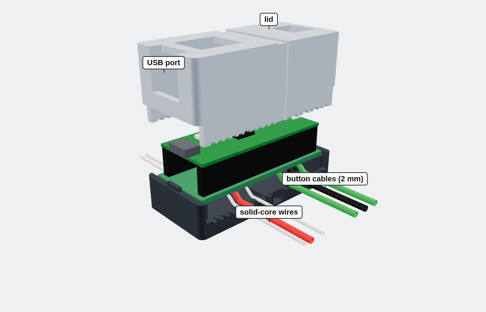
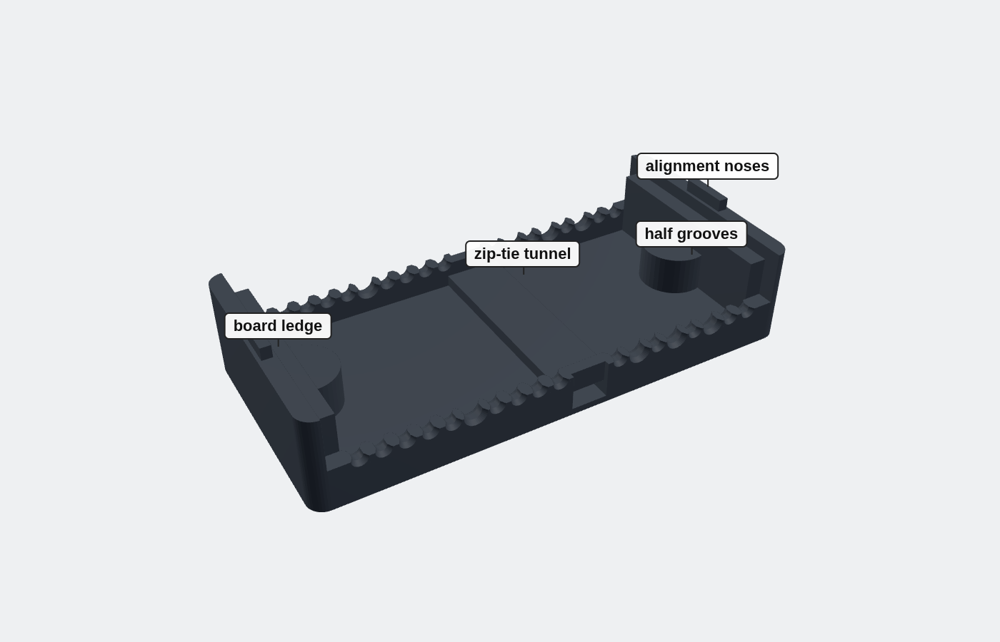
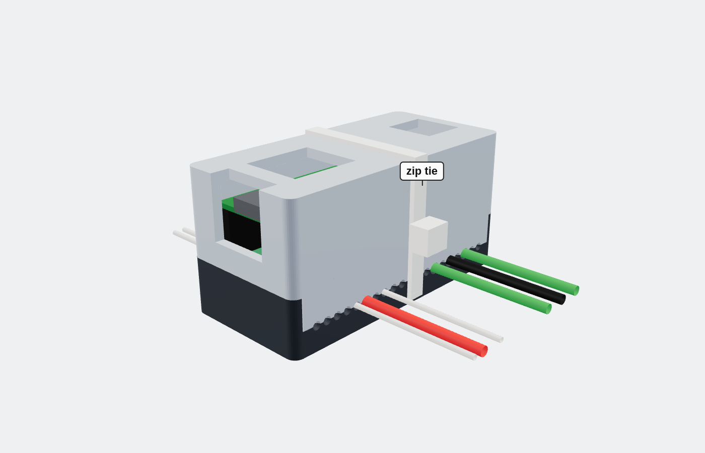
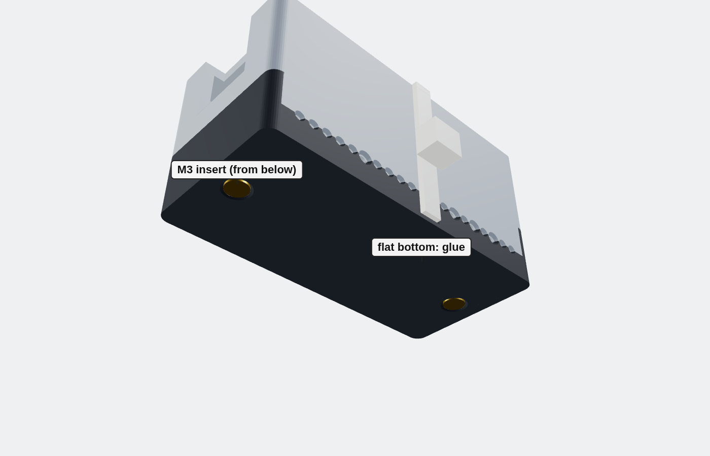
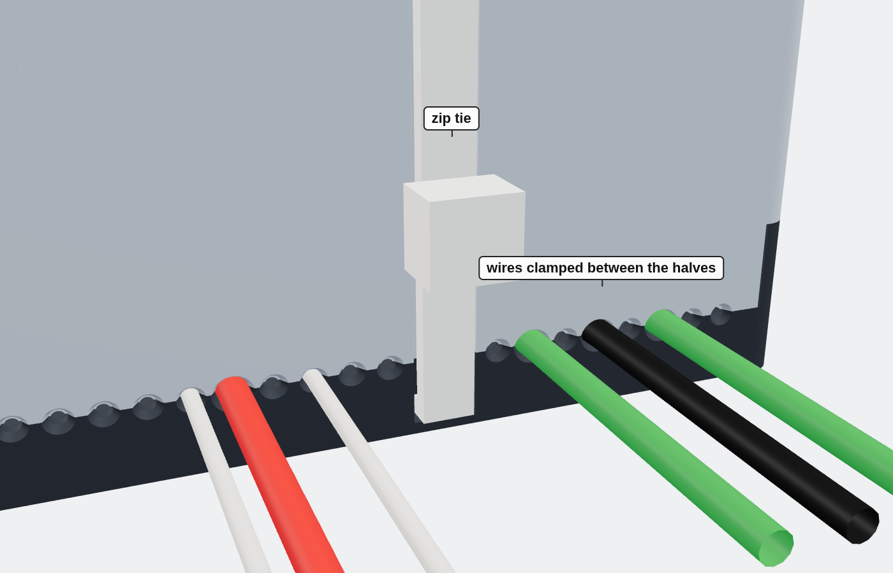

# Enclosure v4

Simple two-part box for the perfboard with the Pico 2 W, held closed by **one zip tie**.
Outside dimensions: **59 × 28 × 29.5 mm**.



- **Wire clamping:** on the long sides the seam drops to wire height, so the wires are
  pinched between base and lid when the zip tie is tightened. Every column C1–C20 has a
  groove on both long sides (except C11–C12, where the zip tie passes). Half of each
  groove is in the base and half in the lid, with a small tooth mid-wall that bites into
  the insulation. Grooves for C6, C14, C16, C18 are 2 mm (button cables), the rest
  1.1 mm (solid-core wire).
- **Zip tie:** 3.6 mm wide, at least 150 mm long. It runs through a tunnel in the base,
  so the bottom stays flat.
- **Mounting:** glue the flat bottom, or use the two M3 heat-set inserts (Ø4 × 5.5 mm)
  from below.
- **Openings:** USB, BOOTSEL/LED window, debug connector.

| File | Description |
| --- | --- |
| `enclosure_v4.scad` | Parametric source (OpenSCAD 2021.01+) |
| `base.stl` | Base, print as is |
| `lid.stl` | Lid, already flipped for printing |
| `test_piece.stl` | Two small blocks with 1.0 / 1.1 / 1.2 / 2.0 mm channels: print first to check the wire grip with your printer |

Regenerate a part:

```sh
openscad -D 'part="base"' -o base.stl enclosure_v4.scad      # base | lid | lid_view | test_piece | all | exploded
```

The main parameters (wire diameters, bite, tooth, clearance, solder protrusion under the
board) are at the top of the file. If the test piece grips too much or too little, adjust
`bite_solid` / `bite_cable`.

| | |
| --- | --- |
|  |  |
|  |  |
