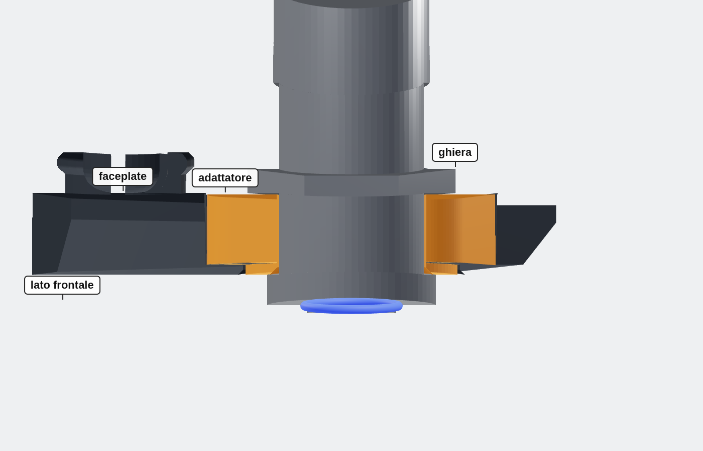
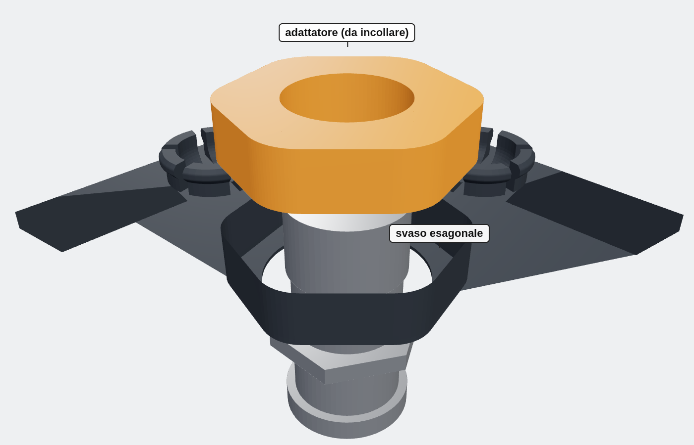

# REDUX faceplate adapter for a 12 mm button

Fills the hexagonal counterbore behind the power-button hole of the REDUX BC-250 case
faceplate, so a standard **12 mm (M12 × 0.75) momentary button** can be mounted there.
The button goes in from the front and its nut tightens from behind; the adapter is glued
into the counterbore.

- Counterbore measured from the faceplate: rounded hexagon, 23.46 mm across flats,
  corner radius ~5.3 mm, 6.0 mm deep; front hole Ø18 mm in a 0.8 mm skin.
- Total thickness 6.7 mm (the button accepts panels up to 8 mm).
- Print with the large (back) face on the bed, no supports.

| File | Description |
| --- | --- |
| `button_adapter_12mm.scad` | Parametric source |
| `button_adapter_12mm_gap0.20.stl` | 0.20 mm clearance per side (accurate printers) |
| `button_adapter_12mm_gap0.30.stl` | 0.30 mm clearance per side (if the first one is tight) |

No thread is printed: a 12.4 mm plain hole is stronger and the button's own nut does
the clamping.

